<p align="center">
  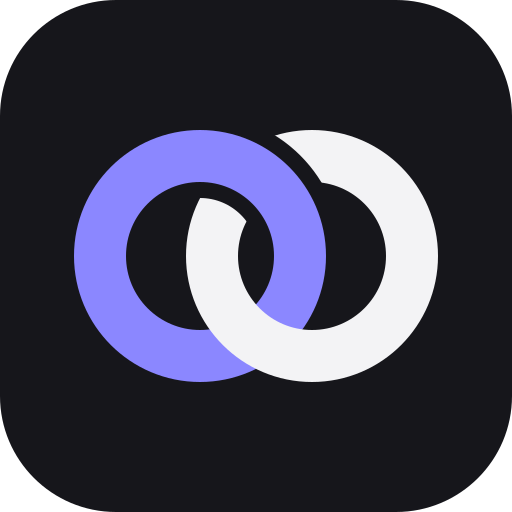
</p>

<h1 align="center">NEXO para computador</h1>

<p align="center">
  Tarefas, hábitos, finanças, academia, estudos e agenda num lugar só.<br>
  O mesmo NEXO do site, num app próprio para Windows, macOS e Linux.
</p>

<p align="center">
  <a href="https://github.com/RichardtJustke/nexo-desktop/releases/latest"><b>Baixar a versão mais recente</b></a>
  ·
  <a href="https://nexo.richardtjustke.tech">Abrir no navegador</a>
</p>

<p align="center">
  
</p>

## Baixar

Na [página de versões](https://github.com/RichardtJustke/nexo-desktop/releases/latest), em **Assets**, escolha o arquivo do seu sistema:

| Sistema | Arquivo |
| --- | --- |
| Windows 10 e 11 | `Nexo_x.y.z_x64-setup.exe` |
| macOS (Apple Silicon: M1 em diante) | `Nexo_x.y.z_aarch64.dmg` |
| Ubuntu, Debian, Mint, Pop!_OS | `Nexo_x.y.z_amd64.deb` |
| Qualquer outro Linux | `Nexo_x.y.z_amd64.AppImage` |

Você entra com a mesma conta do site, e tudo fica sincronizado com o celular e o navegador.

### Linux pelo terminal

```bash
curl -fsSL https://raw.githubusercontent.com/RichardtJustke/nexo-desktop/main/install.sh | bash
```

O script escolhe sozinho entre `.deb` e AppImage e cria o atalho no menu. Também serve para atualizar (`install.sh update`) e remover (`install.sh uninstall`).

### Primeira vez abrindo

O app ainda não tem assinatura digital, então o sistema avisa na primeira vez:

- **Windows:** na tela azul "O Windows protegeu o computador", clique em **Mais informações** → **Executar assim mesmo**.
- **macOS:** se aparecer "Nexo está danificado" ou "não pode ser aberto", arraste o app para **Aplicativos** e rode no Terminal:
  ```bash
  xattr -cr /Applications/Nexo.app
  ```
- **AppImage:** dê permissão de execução (`chmod +x Nexo_*.AppImage`) e abra.

## O que tem

<table>
  <tr>
    <td>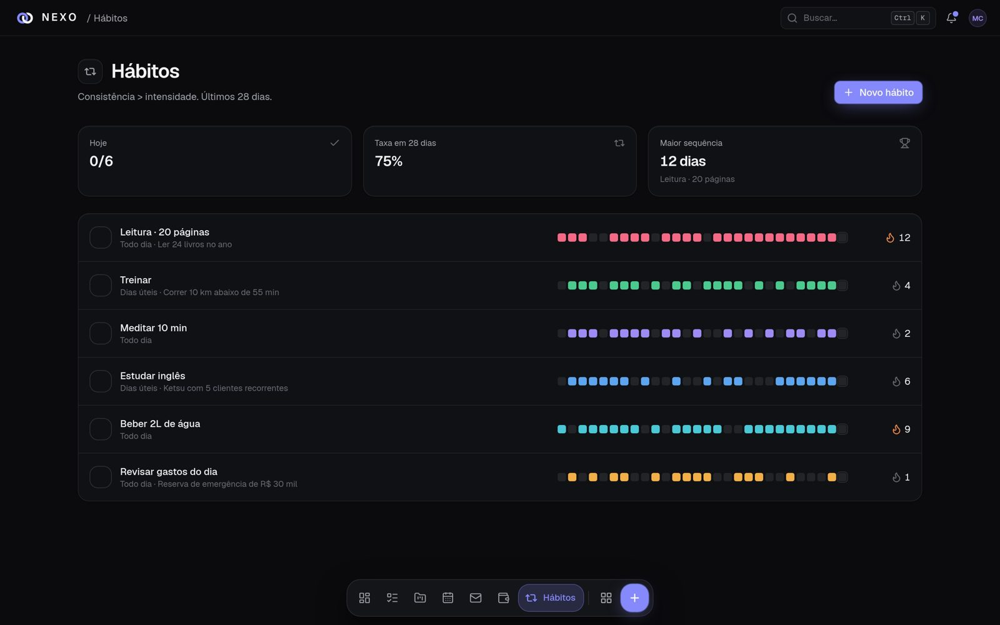<br><b>Hábitos</b>: sequências, metas por dia e histórico.</td>
    <td>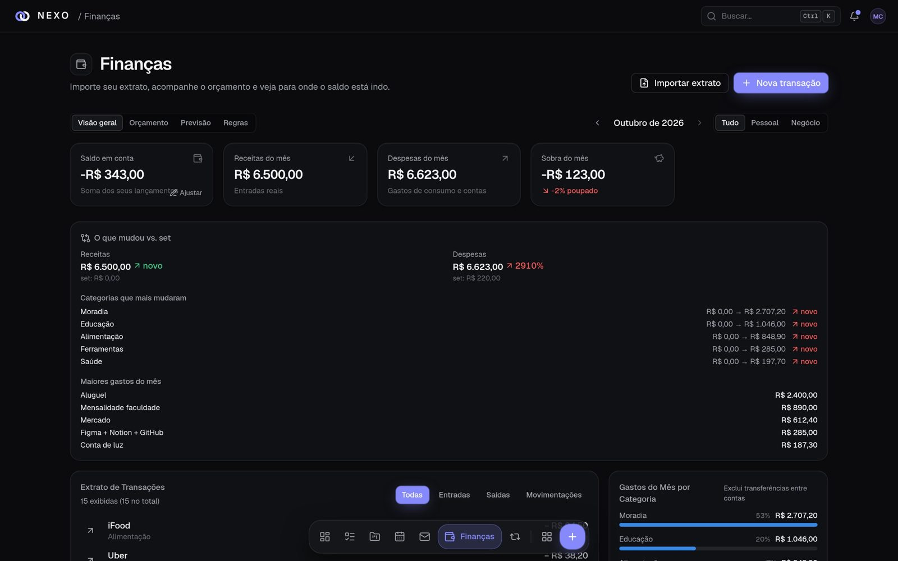<br><b>Finanças</b>: contas, orçamento, dívidas e previsão.</td>
  </tr>
  <tr>
    <td>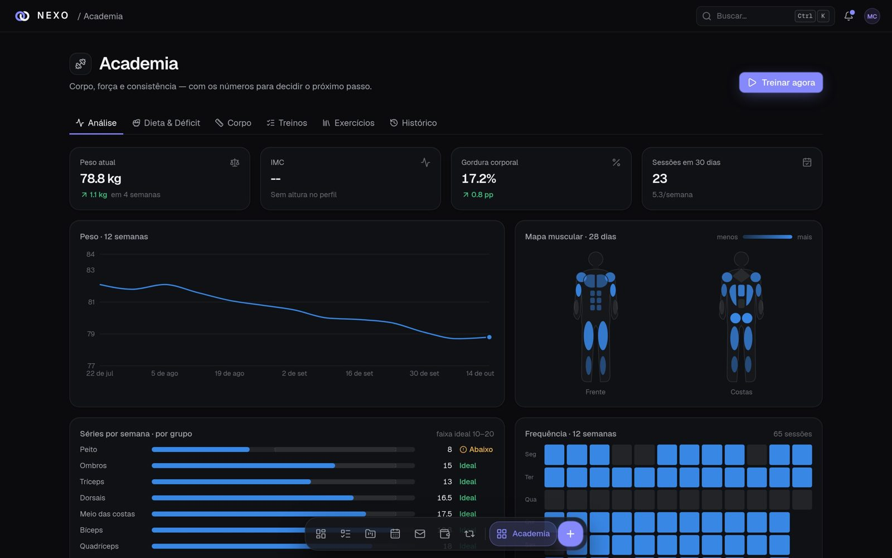<br><b>Academia</b>: treinos guiados, cargas, corpo e dieta.</td>
    <td>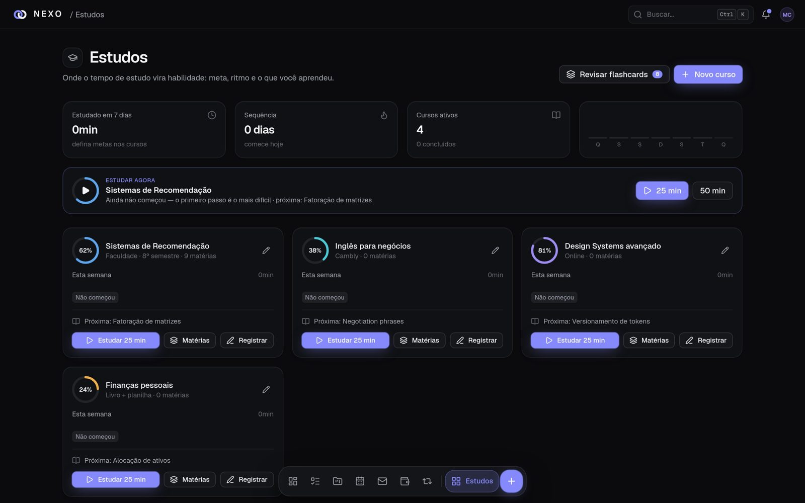<br><b>Estudos</b>: trilhas, resumos, mapas e flashcards.</td>
  </tr>
  <tr>
    <td>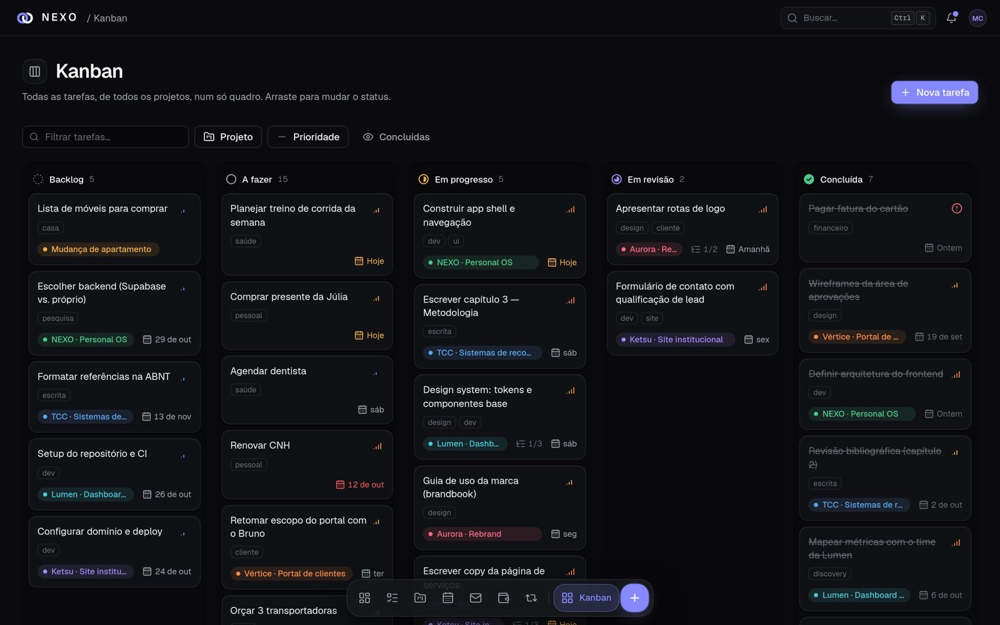<br><b>Projetos</b>: quadros, tarefas e prazos.</td>
    <td>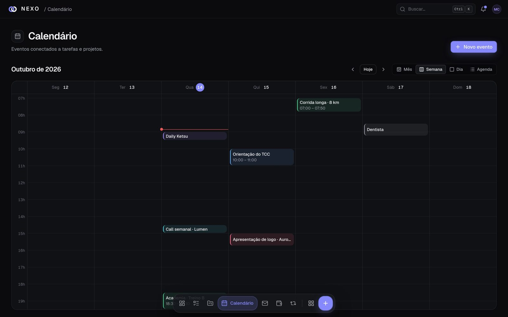<br><b>Agenda</b>: eventos, rotina e o plano do dia.</td>
  </tr>
  <tr>
    <td>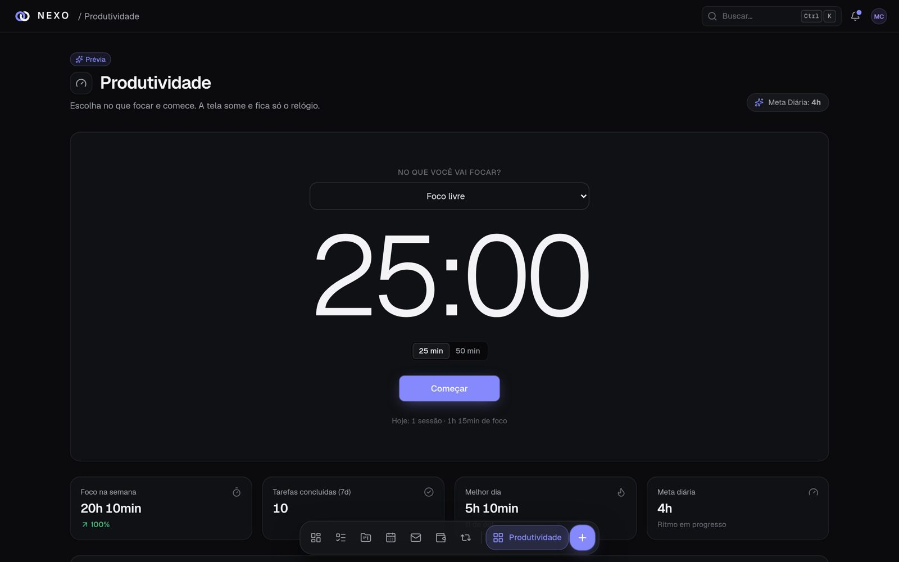<br><b>Foco</b>: blocos de foco e tempo por projeto.</td>
    <td>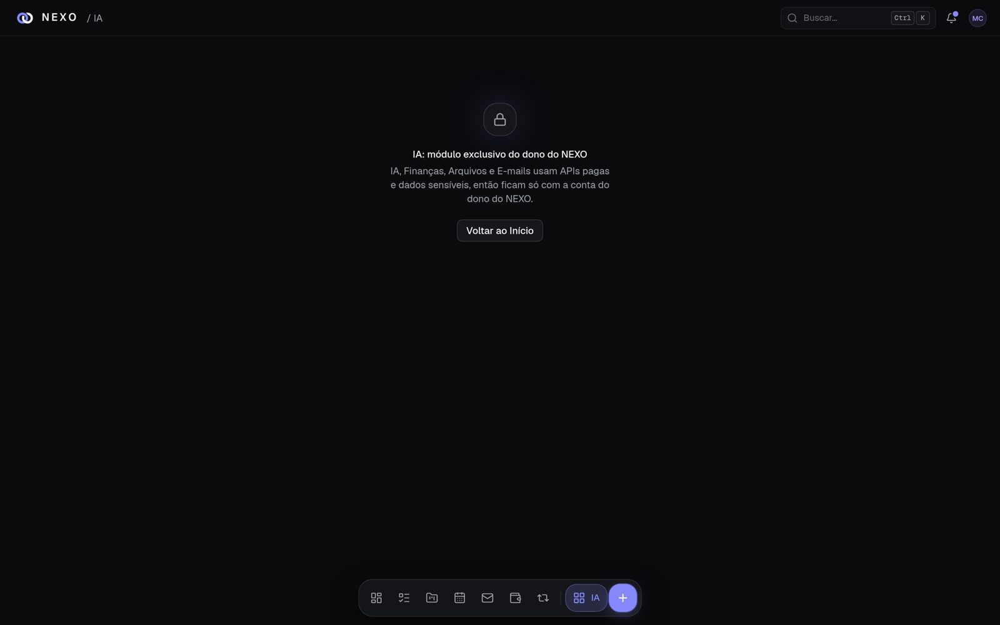<br><b>James</b>: a IA que conhece seus dados e ajuda a planejar.</td>
  </tr>
</table>

## Também no celular

<p>
  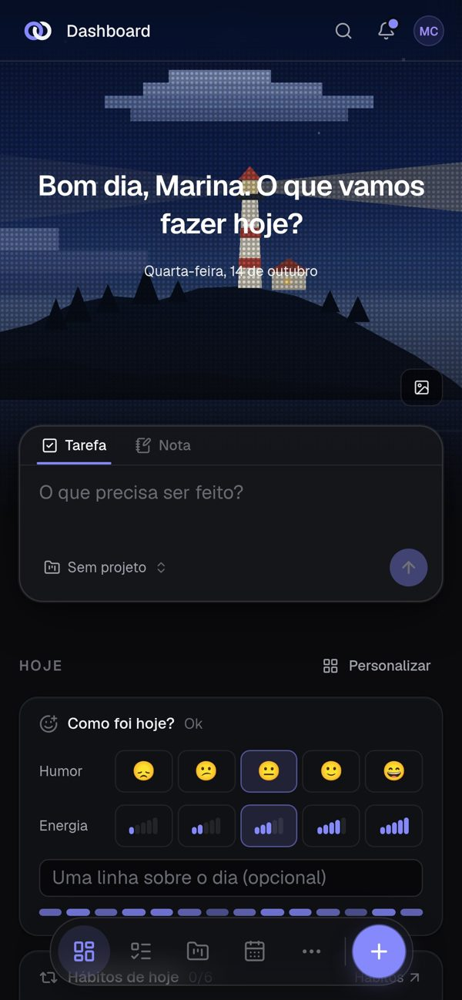
  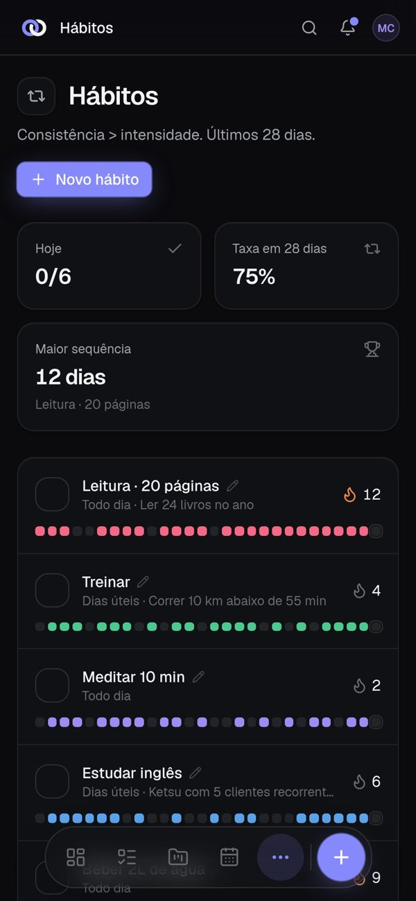
  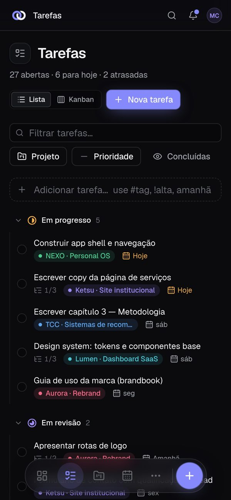
</p>

No iPhone e no Android, abra [nexo.richardtjustke.tech](https://nexo.richardtjustke.tech) e use **Adicionar à tela de início**.

## Sobre este repositório

Aqui ficam só os instaladores (em **Releases**) e o script de instalação do Linux. O código do NEXO não é aberto.

Achou um problema? Abra uma [issue](https://github.com/RichardtJustke/nexo-desktop/issues) contando o sistema, a versão do app e o que aconteceu.

© 2026 Ketsu
